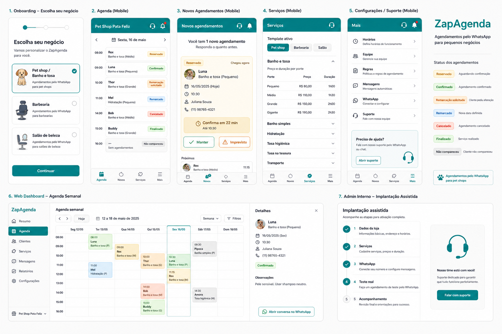
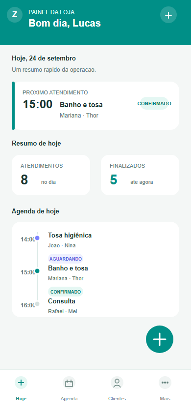

# ZPA

O **ZPA** é uma experiência de agenda para negócios que recebem solicitações pelo WhatsApp. A plataforma aproxima a conversa do cliente da operação diária da loja, organizando horários, serviços, clientes e pets em uma jornada simples.

O projeto é idealizado, arquitetado e desenvolvido por **Lucas Vieira**.

> Projeto funcional em ambiente de demonstração. O código de produção e a infraestrutura permanecem privados.

## O problema

Pequenos negócios costumam controlar seus horários em conversas, planilhas e anotações espalhadas. Isso torna difícil saber o que está confirmado, remarcar um atendimento, recuperar um horário perdido e acompanhar o movimento da loja.

## A solução

O ZPA organiza a operação em um único fluxo:

1. O cliente solicita um horário pelo WhatsApp.
2. A loja visualiza a disponibilidade e confirma o agendamento.
3. O comerciante acompanha clientes, pets, serviços e histórico.
4. Remarcações, cancelamentos e finalizações permanecem registrados.
5. O dashboard mostra a operação e os indicadores do período.

## O produto em funcionamento

As imagens abaixo representam a direção visual e a experiência do produto. Dados pessoais, credenciais e informações reais de clientes não fazem parte deste showcase.

### Visão geral da experiência

A interface reúne agenda, resumo operacional e ações rápidas em uma experiência responsiva para o uso cotidiano.

### Conceito mobile

O aplicativo mobile foi pensado para uma operação rápida, com navegação inferior, cartões legíveis, ações acessíveis com uma mão e suporte a tema escuro.

## Experiências principais

### Agenda

- Visões por dia, semana, mês e ano.
- Criação de agendamentos manuais.
- Confirmação, remarcação, cancelamento e finalização.
- Controle de capacidade, pausas e bloqueios.
- Detalhes do cliente, pet, serviço e contato.

### Clientes e pets

- Cadastro associado ao WhatsApp.
- Perfil do cliente com seus pets.
- Preenchimento assistido durante o agendamento.
- Histórico operacional para reduzir retrabalho.

### Operação da loja

- Serviços e preços configuráveis.
- Indicadores de atendimentos finalizados.
- Visão financeira protegida para o comerciante.
- Recorrências e fila de espera em evolução.

### Experiência mobile

- Dashboard compacto para consulta rápida.
- Navegação inferior com áreas essenciais.
- Tema claro e escuro persistente.
- Feedback visual para ações importantes.
- Interface adaptada para telas menores.

## Como foi desenvolvido

O desenvolvimento parte dos fluxos reais de uma loja: receber uma solicitação, encontrar um horário, confirmar o cliente, executar o serviço e manter o histórico confiável. A interface web e o aplicativo mobile compartilham o mesmo domínio do produto, mas cada um foi pensado para o contexto em que será usado.

As decisões de produto priorizam:

- reduzir a quantidade de passos em tarefas repetidas;
- evitar duplicidade de clientes e agendamentos;
- manter o comerciante informado quando uma ação altera a agenda;
- proteger informações financeiras sem esconder os dados necessários à operação;
- tratar conexão, autenticação e permissões como parte da experiência.

## Tecnologias

- Next.js, React e TypeScript na experiência web;
- Expo e React Native na experiência mobile;
- Supabase Auth, PostgreSQL e Storage na camada de dados;
- funções de banco e políticas de acesso para isolamento entre lojas;
- testes de domínio, contratos e fluxos de interface.

## Estado do projeto

O MVP está funcional para demonstrações controladas. Os fluxos centrais de agenda, clientes, pets, serviços, autenticação e operação mobile estão implementados. A integração real com WhatsApp e pagamentos permanece planejada para uma etapa posterior.

O showcase apresenta o produto e suas decisões sem publicar o código de produção, credenciais, migrations reais ou dados privados.

## Princípios do produto

- **Clareza:** o comerciante entende o que precisa fazer agora.
- **Proximidade:** a jornada começa no canal que o cliente já usa.
- **Confiabilidade:** mudanças importantes deixam um estado claro.
- **Privacidade:** cada pessoa vê apenas o que precisa para sua função.
- **Mobile first:** a operação funciona bem no celular, sem abandonar a web.

_Showcase atualizado em novembro de 2026._
